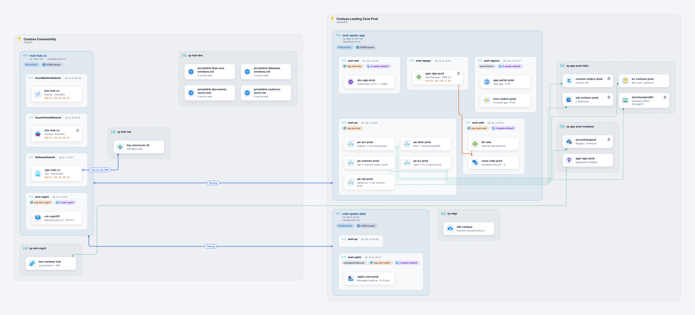
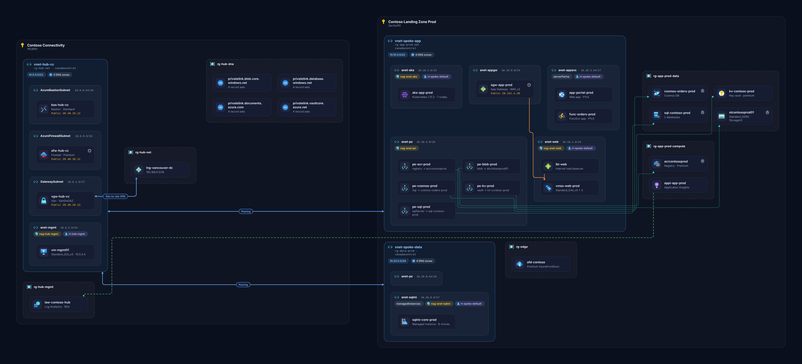
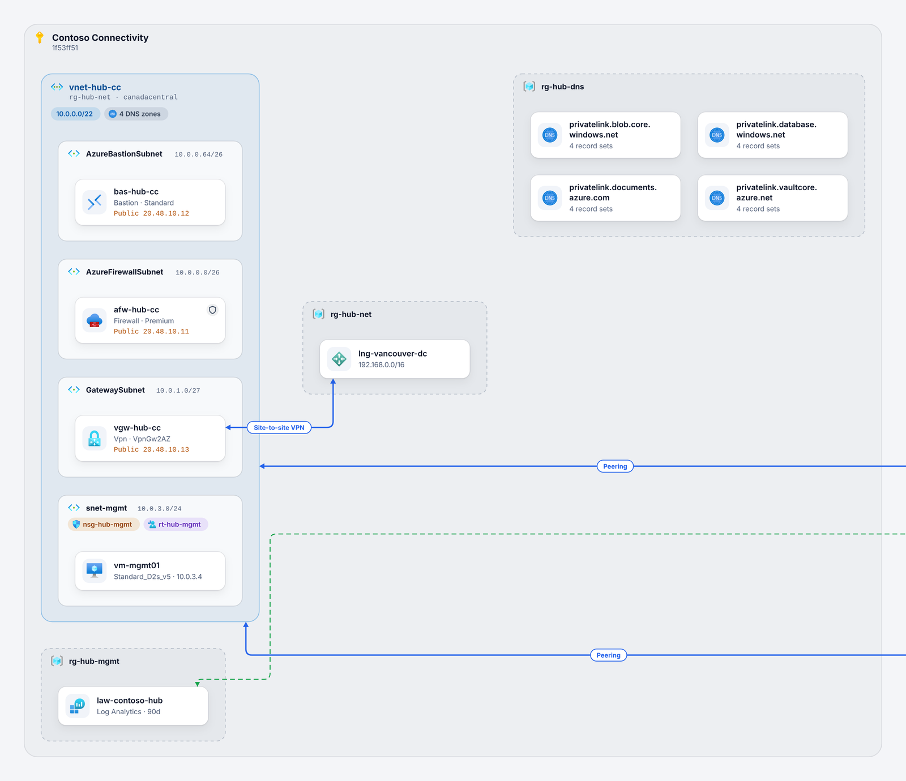
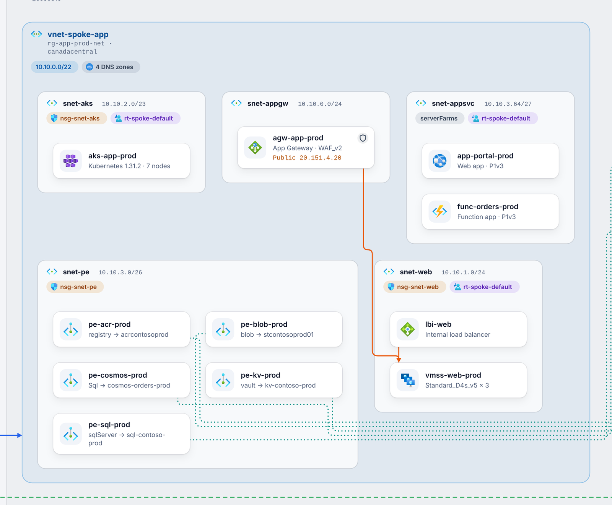
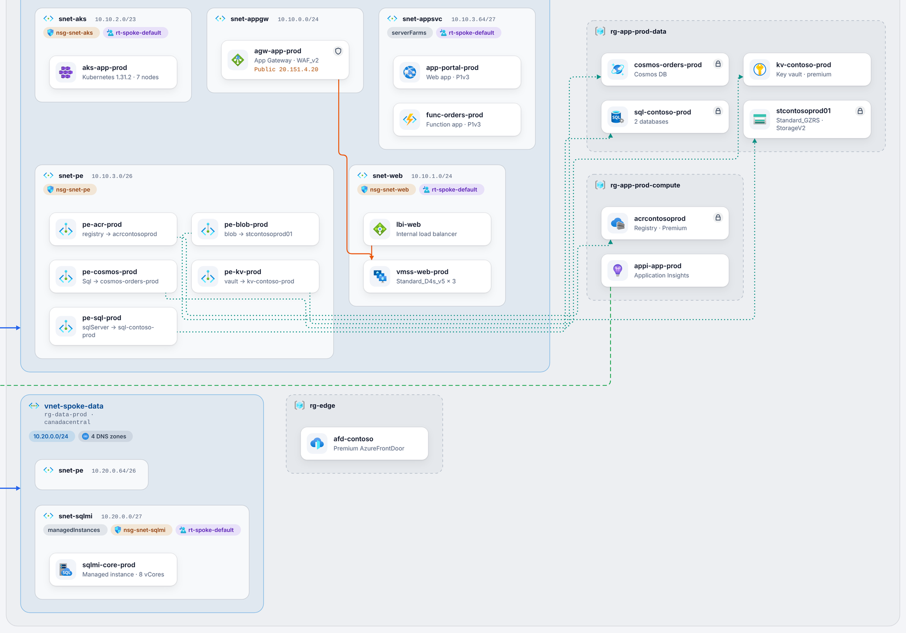
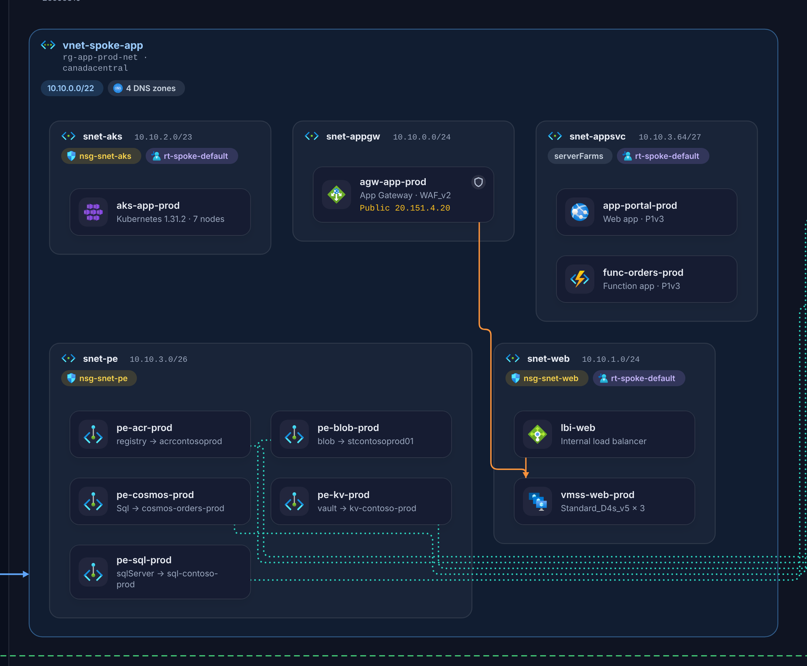

# Another Azure Infrastructure to Diagram

Turn a read-only snapshot of your Azure setup into a clean architecture diagram with Azure icons. Everything after the export runs **in your browser**. There is no server, no Azure calls and nothing is uploaded.

**Live viewer:** https://ashwnn.github.io/better-az2diagram/ (drop your `inventory.json` on it, or press "Try the sample")



<details>
<summary>Dark theme</summary>



</details>

## How it works

```
 PowerShell module            GitHub Pages viewer (static HTML)
 Export-AzureInfraSnapshot -> inventory.json -> drop it on the page -> diagram, built in your browser
 (read-only, ~3 queries)      (one file)
```

1. **Export** a snapshot with the PowerShell module in [`powershell/AzureInfraDiagram`](powershell/AzureInfraDiagram). It runs a few Azure Resource Graph queries and writes one JSON file.
2. **Open** the viewer (the GitHub Pages site, or `dist/index.html` if you build it yourself) and drop the file on it. You can also put the file next to the page and open `?src=inventory.json`.
3. **Explore**: pan and zoom, hover to highlight connections, click for details, search, switch line types on and off, and export SVG or PNG.

## Quick start

1. Export a snapshot. Reader access is enough. You need either Az.ResourceGraph or the Azure CLI with the resource-graph extension.

   ```powershell
   Import-Module ./powershell/AzureInfraDiagram
   Connect-AzAccount
   Export-AzureInfraSnapshot -Path ./inventory.json
   ```

2. Open https://ashwnn.github.io/better-az2diagram/ and drop `inventory.json` onto it.

The snapshot contains resource names, IDs and IP addresses, so keep it private. `inventory.json` is git-ignored so you do not commit it by accident. The viewer runs entirely in your browser, so your file is never sent anywhere. If you want to be sure, build the viewer yourself and open it offline (see Development).

## What you get

| | |
|---|---|
|  |  |
| Hub network with gateway, firewall, bastion and the VPN to on-premises | Spoke with subnets laid out as grids, NSG and route table chips, public IPs and private endpoints |
|  |  |
| Resource groups, SQL Managed Instance and linked services | Same diagram in the dark theme |

- Nested containers for subscriptions, virtual networks, subnets and resource groups.
- 101 official Azure Architecture Icons, used as they are.
- Different line styles for peering, VPN and ExpressRoute, private link, load balancer and Application Gateway backends, and monitoring. DNS links and managed identity role assignments are optional.
- Minor resources such as NICs, disks, SQL databases, NSGs and route tables show up as badges or chips instead of full cards.

## Read-only by design

The exporter only calls `Get-AzSubscription` and `Search-AzGraph`. The CLI backend only calls `az account list|show` and `az graph query`, and an allowlist blocks every other `az` command. Subscription IDs are checked to be GUIDs. If you sign in with a Reader-only account, Azure itself will refuse any write. See the [module README](powershell/AzureInfraDiagram/README.md).

## Development

```bash
npm ci
npm run build                 # dist/index.html: the viewer (what GitHub Pages serves)
npm run build:sample          # dist/inventory.html: the viewer with the sample baked in
npm run qa                    # headless layout check + screenshots (needs: npx playwright install chromium)
pwsh ./powershell/tests/e2e-export.ps1 -Out dist/e2e-inventory.json
npm run e2e                   # upload, ?src= and bad-file tests in a real browser
pwsh -c "Invoke-Pester ./powershell/tests"
```

`tools/make_sample.py` regenerates the fictional demo inventory. `tools/build_icons.py` rebuilds the icon bundle from Microsoft's icon zip.

### Publishing your own copy

Fork the repo, then go to **Settings > Pages** and set the source to **GitHub Actions**. Every push to `main` builds and deploys the viewer. You can commit a snapshot to a private fork and open it with `?src=`, but Pages sites are public on most plans, even for private repos.

## Limitations

- The layout is automatic. Very large estates (thousands of resources) still render but take longer, so filter by subscription when you export.
- Some resource types use a generic icon. To add one, add a mapping in `tools/build_icons.py`.
- Connections are worked out from resource properties (peerings, private endpoints, backend pools and so on). Links that only exist in application code or NSG rules are not drawn.

## Licence

MIT, see [LICENSE](LICENSE). Third-party components, including Microsoft's Azure Architecture Icons (their own terms) and elkjs (EPL-2.0), are listed in [THIRD_PARTY_NOTICES.md](THIRD_PARTY_NOTICES.md).
